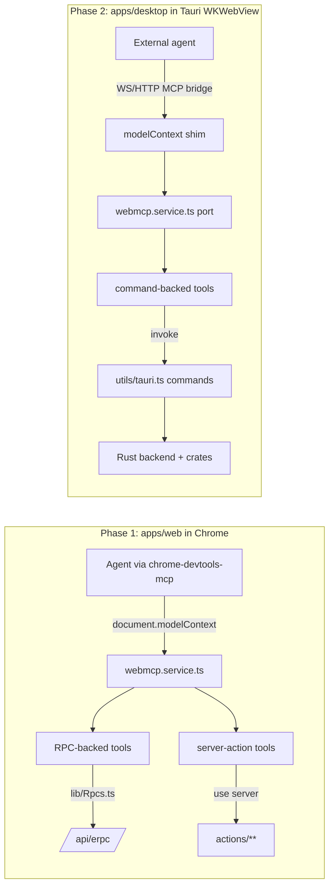

# WebMCP tools for Cap: plan for full control

Status: built. Date: 2026-10-19. Fork: `cap-webmcp` (based on CapSoftware/Cap).

Both phases are implemented on `feat/webmcp` (PR #1): Phase 1 web dashboard
(11 tool groups, ~55 tools) and Phase 2 desktop (bridge + ~41 tools across
recorder, permissions, Studio editor/export, library/recovery, captions),
plus confirm dialogs on both surfaces and an Agent-Enabled catalog widget.
Lint- and typecheck-clean; the desktop bridge is verified end-to-end against
the running app (`webmcp-bridge/{e2e-test,live-check}.mjs`).
The sections below are the original plan; a few deferred items remain
(Gif/Mov were since added; the "area" capture target and a desktop catalog
widget are still open).

## Goal

Let an agent control the **full functionality Cap gives** through **WebMCP** — the
same mechanism our `n8n-webmcp` fork uses: typed tools registered on
`document.modelContext`, called by an MCP client running in the browser
(`chrome-devtools-mcp --categoryExperimentalWebmcp`). Every action the agent
takes is visible on screen, reuses the same stores/commands the UI uses, keeps
secrets out of the agent, and shows a confirm dialog for destructive or
far‑reaching actions.

## The core constraint (why this is a hybrid, not one surface)

Cap's functionality is split across two front ends, and WebMCP requires a
browser an MCP client can attach to over CDP (i.e. **Chrome/Chromium**):

| Surface | Runtime | WebMCP reachable? | Owns |
|---|---|---|---|
| `apps/web` (Next.js) | Real Chrome | **Yes, natively** (exactly like n8n) | Library, sharing, comments, transcripts, Cap AI, analytics, teams, settings, Loom import, storage, billing |
| `apps/desktop` (SolidStart in **Tauri WKWebView**) | Not Chrome, no CDP | **No** — needs a `modelContext` shim + local bridge | Screen/camera/mic capture, Studio editor, zoom/trim/captions, export, local uploads/share links |

No single surface covers everything, so "full control" = **two WebMCP surfaces**
plus a small bridge that makes the desktop webview reachable.

## Architecture

## The WebMCP service pattern to port (from n8n-webmcp)

Source of truth: `n8n-webmcp/packages/frontend/editor-ui/src/features/webmcp/`.
The core (`webmcp.service.ts`) is **framework-agnostic plain TS** and ports as‑is:

- `registerWebMcpTool({ name, description, inputSchema, annotations, execute })`
  queues tools and attaches them to `document.modelContext` when it appears
  (a 1s detect loop). **This late‑attach is exactly what lets the WKWebView shim
  inject `modelContext` after load.**
- Annotations → kind badge: `readOnlyHint` → **read**, `readOnlyHint:false` →
  **write**, `consequentialHint` → **confirm**. `untrustedContentHint` marks data
  that came from outside Cap (comments, transcripts, imported titles).
- `execute` returns a value; the service JSON‑stringifies it and returns errors
  (never throws) so the agent can self‑correct.
- `withWebMcpGroup(group, scope, fn)` stamps tools for an "Agent Enabled" widget.
- A root composable (`useAppWebMcp`) registers global tools on mount; view/canvas
  tools register when that view mounts, with a `waitFor…` readiness poll.

Port targets:
- **Web (React):** a `useCapWebMcp()` hook in a root client component; tools call
  the typed `Rpc` client (`apps/web/lib/Rpcs.ts`) where covered, else server
  actions in `apps/web/actions/**`.
- **Desktop (SolidStart):** a `createCapWebMcp()` run in `onMount` in the root
  layout; tools call the generated `commands` object (`apps/desktop/src/utils/tauri.ts`).

## Existing assets we build on

- **`apps/web/app/api/mcp/route.ts` + `lib/mcp-server.ts` + `lib/mcp-data.ts`** —
  a working, OAuth‑bearer MCP server with 3 read‑only tools (`caps_list`,
  `caps_get`, `caps_context`). Precedent for tool shape and read helpers (but it
  is server-side + bearer auth, not the dashboard session; WebMCP tools run in
  the signed‑in tab instead).
- **`apps/web/lib/Rpcs.ts` + `lib/EffectRuntime.ts`** — typed `@effect/rpc`
  client the dashboard already uses. Covers ~15 ops (VideoDelete, VideoDuplicate,
  Folder CRUD, OrganisationUpdate/SoftDelete, User updates, analytics,
  thumbnails, download info). Reuse directly.
- **`crates/automation` (`cap-automation`)** — a serializable rules engine with a
  14‑variant `Action` enum (`Export`, `Upload`, `CopyToClipboard`, `SaveToLocation`,
  `Webhook`, `Notify`, `RunCommand`, `OpenEditor`, `ApplyPreset`, `DeleteLocalFiles`,
  …) and an `AutomationHost` trait implemented by both desktop and CLI. All types
  derive `specta::Type`, so JSON schemas/TS types generate for free. **Great for
  post‑capture automation tools; it has no start/stop‑recording action** (those
  are triggers/events) — capture control comes from the Tauri commands below.
- **`apps/desktop/src/utils/tauri.ts`** — ~191 generated, typed `commands`
  wrappers (tauri-specta). The desktop tool layer wraps these.

---

## Phases

Order mirrors n8n: get a working WebMCP surface fast (web), then tackle the
custom bridge (desktop).

### Phase 0 — Scaffolding & smoke test
- Add `.mcp.json` with `chrome-devtools-mcp --categoryExperimentalWebmcp`
  (copy from n8n-webmcp).
- Port `webmcp.service.ts` into a shared location (e.g. a small internal package
  or duplicated per app to start).
- Register ONE trivial tool in `apps/web` (`get_current_view`) and confirm the
  agent can list + call it in Chrome. Proves the pipe end‑to‑end.

### Phase 1 — Web dashboard WebMCP (mirror n8n)
Everything server-side, in the signed‑in Chrome tab. Scope `global`.

| Group | Representative tools | Backed by | Kind |
|---|---|---|---|
| Navigation & orientation | `get_current_view`, `navigate_to`, `show_notification` | router / toast | read/write |
| Library | `list_caps`, `get_cap`, `rename_cap`, `edit_cap_date`, `update_cap_settings`, `duplicate_cap`, `delete_cap` | `lib/mcp-data.ts`, RPC VideoDelete/Duplicate, `actions/videos/*` | read/write/**confirm** |
| Folders | `create_folder`, `update_folder`, `delete_folder`, `move_cap_to_folder` | Folder RPCs, `actions/folders/*` | write/**confirm** |
| Sharing | `share_cap`, `set_cap_password`, `remove_cap_password`, `invite_viewer`, `revoke_viewer`, `set_call_to_action` | `actions/caps/share.ts`, `actions/videos/password.ts`, `viewer-invites.ts` | write/**confirm** |
| Custom domains | `add_domain`, `verify_domain`, `check_domain_status`, `remove_domain` | `actions/organization/domain-utils.ts` | write/read/**confirm** |
| Comments | `list_comments`, `add_comment`, `delete_comment` | `actions/videos/new-comment.ts`, `delete-comment.ts` | read/write/**confirm** (untrusted on read) |
| Transcripts & captions | `get_transcript`, `edit_transcript_entry`, `translate_transcript`, `retry_transcription` | `actions/videos/*transcript*`, retry route | read/write (untrusted on read) |
| Cap AI | `generate_ai`, `retry_ai`, `edit_ai_content` | `lib/generate-ai.ts`, `actions/videos/edit-ai-content.ts` | write (entitlement‑gated) |
| Analytics | `get_cap_analytics`, `get_dashboard_analytics` | RPC VideosGetAnalytics, analytics routes | read |
| Teams / spaces | `update_org`, `invite_member`, `remove_member`, `update_member_role`, `create_space`, `update_space`, `delete_space` | Organisation RPCs, `actions/organization/*` | write/**confirm** |
| Settings / account | `update_user`, `set_notification_prefs`, `complete_onboarding_step` | User RPCs, `actions/notifications/*` | write |
| Loom import | `list_loom_folders`, `import_from_loom`, `import_from_loom_csv` | `actions/loom.ts` | read/write |
| Storage config | `get_storage_settings`, `save_s3_config`, `test_s3_config`, `set_storage_provider` | `actions/organization/storage.ts` | read/write/**confirm** |
| Billing (read‑first) | `get_subscription`, `get_billing_usage`, `open_billing_portal` | `actions/organization/*billing*` | read/write |

Billing **purchases** (subscribe, seat increase, BAA, credits) are out of scope
for agent execution — surface them read‑only and hand the user the portal link.

### Phase 2 — Desktop recorder/editor WebMCP + local bridge
The hard, custom part. Two sub-pieces:

**2a. The bridge (makes WKWebView reachable).** Because `chrome-devtools-mcp`
cannot attach to WKWebView, the desktop app itself exposes the tools:
- Inject a `document.modelContext` **shim** into the SolidStart webview that
  implements `registerTool` and forwards calls over a **local transport** (a
  localhost WebSocket/HTTP server hosted by the Tauri app, loopback‑only, origin‑
  checked, with a per‑session token).
- Provide a tiny **MCP stdio/HTTP adapter** the external agent connects to, which
  relays to that local transport. (Alternative: embed a Rust MCP server in the
  Tauri app and have tools call commands directly — evaluate vs. the shim once
  Phase 1 lands.)

**2b. The desktop tools.** SolidStart `onMount`, scope `global` (plus editor‑only
tools when the editor is open). All call `commands` from `utils/tauri.ts`.

| Group | Representative tools | Backed by (command) | Kind |
|---|---|---|---|
| Permissions | `check_permissions`, `request_permission`, `open_permission_settings` | `permissions::*` | read/write |
| Sources | `list_displays`, `list_windows`, `list_cameras`, `list_mics`, `select_camera`, `select_mic`, `set_recording_mode` | `recording::list_*`, `set_camera_input`, `set_mic_input`, `recording_settings::set_recording_mode` | read/write |
| Recording lifecycle | `start_recording`, `stop_recording`, `pause_recording`, `resume_recording`, `get_recording_state`, `take_screenshot`, `restart_recording`, `delete_recording` | `recording::*`, `get_current_recording` | write/read/**confirm** (restart/delete) |
| Studio editor | `open_editor`, `get_project_config`, `set_project_config`, `generate_zoom_segments`, `seek`, `start_playback`, `stop_playback`, `delete_project` | editor commands in `lib.rs`, `editor_recording::*` | read/write/**confirm** (delete) |
| Captions | `transcribe_audio`, `save_captions`, `export_srt`, model mgmt | `captions::*` | write/**confirm** (model delete) |
| Export | `export_video`, `export_to_file`, `get_export_estimates`, `cancel_export` | `export::*` | write/**confirm** (overwrite) |
| Import | `import_video`, `import_image`, `add_existing_recording` | `import::*` | write |
| Upload / share | `upload_exported_video`, `upload_screenshot`, `get_share_link` | `upload_*`, `copy_current_screenshot_share_link` | **confirm** (publishes off‑machine) |
| Library | `list_recordings`, `list_screenshots`, `pick_recordings_folder` | `list_*`, `recordings_locations::*` | read/write/**confirm** (migrate) |
| Recovery | `find_incomplete_recordings`, `recover_recording`, `discard_incomplete` | `recovery::*` | read/write/**confirm** |
| Automations | `get_automations`, `set_automations`, `test_automation`, `list_automation_capabilities` | `automation::*` (wraps `cap-automation`) | read/write/**confirm** (test may fire actions) |

**Not Tauri commands** (handle specially): sign‑out and general settings are
frontend `plugin-store` operations; sign‑in is the `cap-desktop://login` deeplink.
`set_server_url` repoints the whole app — treat as **confirm**.

### Phase 3 — Hardening
Agent‑Enabled widget (catalog UI like n8n), per‑tool schema validation against
the generated specta/RPC types, confirm‑dialog wiring for every **confirm** tool,
`untrustedContentHint` on all externally‑sourced reads, and a live round‑trip
test (record → edit → export → upload on desktop; library → share → analytics on web).

## Confirm‑gated (destructive / far‑reaching) — must show a dialog

- **Delete:** `delete_cap`, `delete_folder`, `delete_project`/`delete_recording`,
  `discard_incomplete`, caption model deletes, `clear_presets`, org soft‑delete,
  remove member/invite, remove domain/S3/password.
- **Publish off‑machine:** all `upload_*`, share‑link creation, `upload_logs`,
  diagnostics upload.
- **Overwrite / move on disk:** `export_to_file`, recordings migrate, file copy.
- **Account/environment:** `set_server_url`, reset cam/mic permissions, update &
  install + restart, CLI install/uninstall.
- **Billing purchases:** out of scope for agent execution (read‑only + portal link).

## Open questions
1. Bridge design for 2a: `modelContext` shim + local WS vs. embedded Rust MCP
   server. (Decide after Phase 1; the shim keeps "user sees it on screen".)
2. Shared vs. duplicated `webmcp.service.ts` across the two apps (monorepo
   package vs. copy).
3. Which Chrome/channel + flag the agent uses (`chrome://flags/#enable-webmcp-testing`,
   Chrome 149+) and whether a bundled extension injects `modelContext` in `apps/web`.
4. Auth model for the desktop bridge (loopback + per‑session token).

## Appendix — surface inventory (from discovery)
- Desktop: ~191 Tauri commands; registry in `apps/desktop/src-tauri/src/lib.rs`
  (`specta_builder`); bindings in `apps/desktop/src/utils/tauri.ts`.
- Web: typed RPC (`packages/web-domain` contract, `packages/web-backend` handlers,
  `/api/erpc` mount, `apps/web/lib/Rpcs.ts` client) covering ~15 ops; the rest are
  `apps/web/actions/**` server actions; existing MCP server at `apps/web/app/api/mcp/`.
- Automation engine: `crates/automation` (`cap-automation`), hosts in
  `apps/desktop/src-tauri/src/automation.rs` and `apps/cli/src/automation.rs`.
